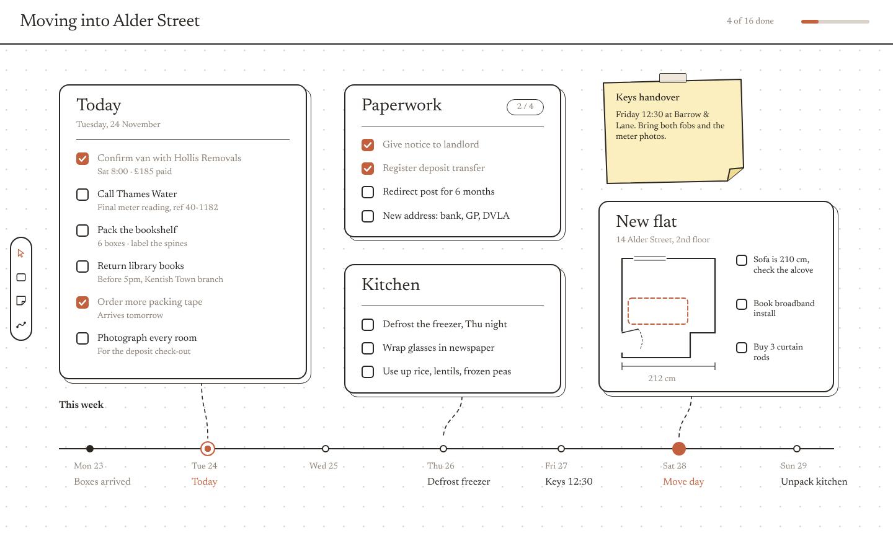
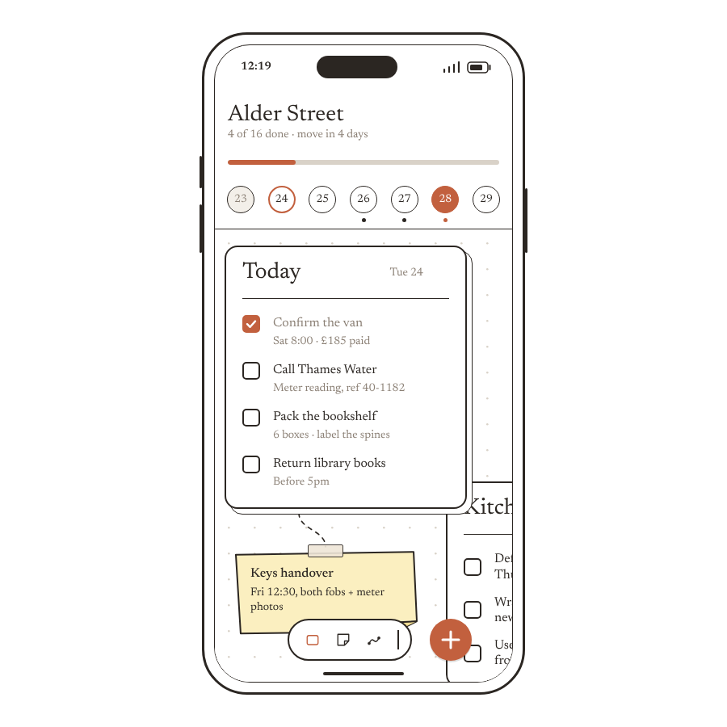

# Alder Street · Todo

A todo app laid out as a canvas you can move around, built from the **"Todo app desktop screen"** whiteboard.
This first version is the frontend only, with mock data for a moving-house week ("Moving into Alder Street").

| Desktop canvas | Mobile |
| --- | --- |
|  |  |

## Run it locally

You need [Node.js](https://nodejs.org) 20 or newer (`node -v` to check).

```bash
git clone https://github.com/alfreddey/todo-app-ai-assisted.git
cd todo-app-ai-assisted
git checkout claude/project-thread-ini3dl   # until the pull request is merged
npm install
npm run dev
```

`npm run dev` starts the app at <http://localhost:5173> and opens it in your browser.

- **Desktop canvas:** open <http://localhost:5173> in a normal-width window.
- **Mobile screen:** open <http://localhost:5173/?view=mobile> to see it inside a phone frame, or make the window narrower than 720px. To try it on your phone, run `npm run dev -- --host` and open the "Network" address it prints (phone and computer on the same Wi-Fi).
- Force the desktop layout with `?view=desktop`.

Other scripts:

| Command | What it does |
| --- | --- |
| `npm run build` | Type-checks and builds a production bundle into `dist/` |
| `npm run preview` | Serves the production build locally |
| `npm run typecheck` | Type-checks only |

## What you can do

- Tick tasks off. The "4 of 16 done" count and progress bar, and the Paperwork "2 / 4" pill, update as you go.
- Drag cards anywhere on the dotted canvas, pan by dragging empty space, and zoom with the trackpad or mouse wheel.
- Use the tool pill on the left: add a list card or a sticky note, or pick the connector to pin a card to a day on the timeline with a dashed thread.
- Click a day on "This week" to select it.
- On mobile, tap a day in the week strip, add a card or note from the bottom pill, and use the **+** button to add a task to Today.

Changes live in memory only and reset on reload; there is no backend yet.

## Stack

React 18, Vite 7 and TypeScript, with [React Flow](https://reactflow.dev) (`@xyflow/react`) for the draggable canvas, as chosen on the low-level design board. The typeface is Newsreader, bundled through Fontsource so it works offline.

## Where things are

```
src/
  App.tsx                 picks desktop or mobile (by width or ?view=)
  data/mockData.ts        the Alder Street tasks, cards and week
  data/store.tsx          in-memory state: tick, add task, add card
  components/
    DesktopCanvas.tsx     header + React Flow canvas, card layout, timeline threads
    MobileScreen.tsx      header, week strip, mobile canvas, dock and add sheet
    Cards.tsx             list card, sticky note, new-flat card with floor plan
    Timeline.tsx          "This week" line with day dots
    ToolPill.tsx          pointer / card / sticky / connector tools
    PhoneFrame.tsx        phone body for the ?view=mobile preview
  styles.css              colour tokens and all styling
```

Colours come straight from the whiteboard: ink `#2b2622`, muted `#8a7f74`, dots and tracks `#d9d2c8`, terracotta accent `#c2603e`, sticky yellow `#fbefc0`.
